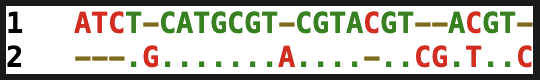
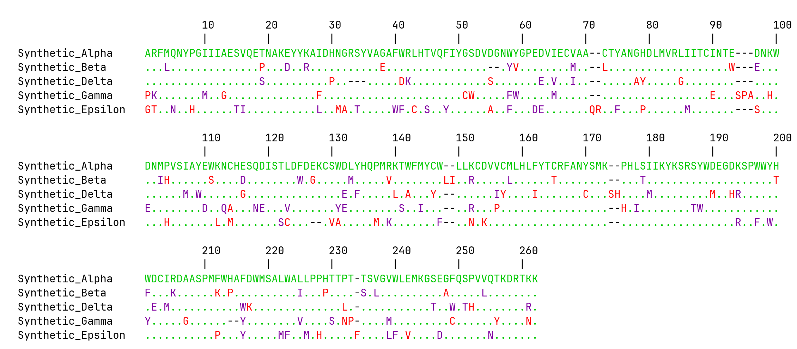

Buttle was developed as a lightweight collection of bioinformatics utilities for common sequence-analysis tasks, with an emphasis on convenient command-line use. It provides tools for working with DNA and protein sequences, including sequence manipulation, peptide properties, motif searching, pairwise alignment, and multiple sequence alignment.

Buttle is currently under active development.

## Features

### General sequence tools

- Search for sequences and report their positions
- Calculate sequence length
- Calculate pairwise percent identity for sequences in a FASTA file

### DNA sequences

- Transcribe to RNA
- Translate in three reading frames
- Generate reverse complements
- Calculate GC content
- Pairwise sequence alignment from two raw sequence arguments
    - Rust backend by default, with a Python backend available
- Multiple sequence alignment (MSA) from FASTA files or FASTA-formatted strings
    - Rust backend by default, with a Python backend available

### Protein sequence tools
- Calculate protein net charge
- Calculate molecular weight
- Calculate extinction coefficient
- Identify and highlight potential N-linked glycosylation sites
- Compare two sequences and look for conserved motifs of varying lengths
- Pairwise sequence alignment from two raw sequence arguments
    - Rust backend by default, with a Python backend available
- Multiple sequence alignment (MSA) from FASTA files or FASTA-formatted strings
    - Rust backend by default, with a Python backend available


### Rendering
- Print alignments in the terminal (when no `--save` argument provided)
- Generate publication-quality PNG and TIFF alignment images
    - Pairwise DNA and Protein alignments
    - Multiple DNA and Protein sequence alignments
    - Alignment row length can be tuned with `--wrap`
    - Argument `--real-ruler` displays residue number based on the first sequence, skipping gaps
        - Optionally add a number at which the ruler numbering will start (defaults to 1)
- Argument `--diff` displays alignment differences relative to a reference sequence (first sequence in FASTA file)
- Argument `--consensus` optionally adds a consensus sequence to the bottom of an MSA
- Argument `--tree` displays an average-linkage clustering of pairwise sequence distances, not a phylogenetic reconstruction


## Installation/Requirements

Buttle is distributed through PyPI and requires Python 3.15 or newer. Prebuilt wheels include both the Python modules and the compiled Rust extension, so Rust and Cargo are not required when installing a compatible wheel.


### Command-line installation

Install Buttle as a standalone command-line tool using uv:

```bash
uv tool install buttle
```

Alternatively, install it with pip:

```bash
pip install buttle
```

Once installed, run:

```bash
buttle --help
```

### Using Buttle in Python


To add Buttle to an existing Python project:

```bash
uv add buttle
```

Or install it into your active Python environment:

```bash
pip install buttle
```

Buttle's Python modules can also be imported and used directly.
```python
from buttle import sequences

# Access functions from the sequences module
output = sequences.find_position(sequence, search_string)
```

For convenience, commonly used classes and functions are also exposed at the package's top level:
```python
from buttle import find_position

# Call functions directly without referencing their modules
output = find_position(sequence, search_string)
```

### Building from source

Prebuilt wheels include the compiled Rust extension, so Rust and Cargo are not required for normal installation on supported platforms.
To build Buttle from source, you'll need Python 3.15+, Rust/Cargo, and a compatible build environment. The Rust toolchain (the Rust compiler and Cargo build system) can be installed from https://rustup.rs.

To verify that Rust is installed, run

```bash
rustc --version
cargo --version
```

Rust is only required during installation to compile the extension; it is not required to run Buttle afterward.


### Using uv to install buttle from source

Installing uv:

The following instructions use uv to install Buttle from source. Other Python build tools may also be used.
If you don't already have uv installed, follow the official installation instructions at 

https://docs.astral.sh/uv/getting-started/installation/

On macOS and Linux, you can install it with:

```bash
curl -LsSf https://astral.sh/uv/install.sh | sh
```

Verify the installation:

```bash
uv --version
```

Install Python 3.15:

```bash
uv python install 3.15
```

Clone the repository:
```bash
git clone https://github.com/DJV512/buttle/
cd buttle
```

Finally, install Buttle using uv:

```bash
uv tool install --python 3.15 .
```

After installation:
```bash
buttle -h
```

## Usage

Buttle provides a command-line interface:
```bash
buttle <command> [options]
```

For a list of available commands:
```bash
buttle -h
```

For help with an individual command:
```bash
buttle msa -h
```

## Development

### Rebuilding the Rust extension

After modifying Rust source code, rebuild and reinstall Buttle
from the repository root:

    uv tool install --reinstall -e .

This recompiles the Rust extension and updates the globally
installed `buttle` command.

## Examples

#### Translate DNA in all three forward reading frames.

```console
$ buttle translate acttactggtcgtagtca
Frame 1: TYWS*S
Frame 2: LTGRS
Frame 3: LLVVV
```

#### GC Content

```console
$ buttle gc atgacggtagctagtagctacgtatcattcatctatccgcgcgtagtagtacgt
Total bases: 54
A: 13
C: 12
G: 13
T: 16
AT Content: 53.70
GC Content: 46.30
```

#### Display protein charge, molecular weight, and extinction coefficient together with props, or calculate each individually.
```console
$ buttle props adlsykfehyaskgascwedasdkflsdad
Charge = -4
Molecular Weight = 3357.6
Extinction Coefficient = 8370
```

#### Pairwise Alignment of DNA or Protein
```console
$ buttle dna_align atctcatgcgtcgtacgtacgt tgcatgcgtacgtagtcgatgtc --diff
```


#### Multiple Sequence Alignment
Buttle implements a custom progressive multiple sequence alignment algorithm using an average-linkage guide tree with tunable affine gap open and extension penalties. For Proteins, Buttle uses BLOSUM62-based scoring. Optional "X" residues can be used as alignment anchors. For DNA, Buttle uses fixed base match and mismatch scoring. Computationally intensive operations are accelerated using a Rust extension.


```console
$ buttle msa docs/examples/synthetic_example_proteins.fasta --save docs/images/synthetic_alignment_protein.png --diff --wrap 100
```


Conservative substitutions are shown in purple, non-conservative substitutions in red, and gaps as black dashes. When `--diff` is enabled, identities to the reference sequence are shown as dots. For DNA, conservative substitutions are disabled.

The Protein sequences used in this example are available in
[synthetic_example_proteins.fasta](docs/examples/synthetic_example_proteins.fasta). A similar set of synthetic DNA sequences is available in [synthetic_example_dna.fasta](docs/examples/synthetic_example_dna.fasta).

If the `--tree` argument is supplied, the average-linkage guide tree that was used to construct the multiple sequence alignment is printed to the terminal in a readable, hierarchical format. `*` represents internal `Cluster` nodes.

```text
root
├── *
│   ├── *
│   │   ├── *
│   │   │   ├── Synthetic_Alpha
│   │   │   └── Synthetic_Beta
│   │   └── Synthetic_Delta
│   └── Synthetic_Gamma
└── Synthetic_Epsilon
```

#### Rust vs Python
The computationally intensive sequence alignment algorithms in Buttle were originally implemented in Python and subsequently ported to Rust to improve performance.
The Rust implementations are used by default, but the original Python implementations remain available for comparison, testing, and experimentation.
When Buttle is installed, you can select the Python implementation for supported alignment commands using:

```console
buttle msa sequences.fasta --backend python
```

Omitting `--backend` uses the Rust implementation.

**Installation note:** Buttle includes a compiled Rust extension, even when using the Python alignment backend. Python-only installation is not currently supported.

## Development status

Buttle is currently in development. Interfaces and command-line options may change before version 1.0. If you find any issues, please report them [here](https://github.com/DJV512/Buttle/issues).

## License

Buttle is licensed under the BSD 3-Clause License.